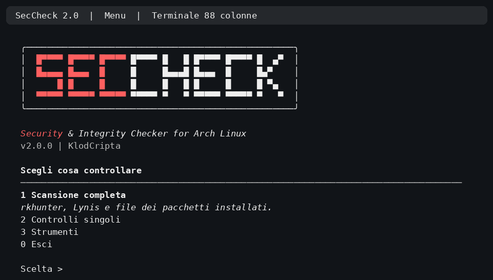
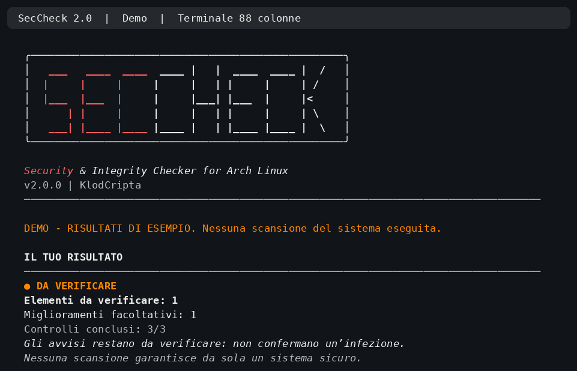

# SecCheck 2.0 — development

A terminal security assistant for **Arch Linux and its derivatives**.
Choose English or Italian, start a scan and let SecCheck investigate the warnings.



## Start

```bash
git clone --branch codex/seccheck-2.0 https://github.com/KlodCripta/seccheck.git
cd seccheck
bash seccheck.sh
```

Choose **1 English** or **2 Italiano**. SecCheck checks the tools at startup and
shows missing packages only. Accept their installation with pacman or continue
with the available checks. Scans request root through sudo when needed.

The main menu has three actions:

1. **Full scan:** rkhunter, Lynis and package-file integrity.
2. **Individual checks:** choose one of those checks.
3. **Tools:** dependencies or rkhunter signature updates.

## After a scan

The initial result shows the number of items to verify and any incomplete checks.
It asks: **“Vuoi che faccia io le verifiche del caso al posto tuo?”**

- **s** in Italian, **y** in English: analyze the warnings automatically.
- **m**: show the warnings first, then return to the choice. The technical report
  is available here too, without accepting automatic analysis.
- **0** or Enter: finish with the initial result.

Automatic analysis compares supported files with their local package records,
checks SSH settings/version and investigates reported temporary files under `/dev`.
It uses the existing privileges. The final result separates explained warnings,
remaining items and optional improvements. Original evidence remains available.

**Remaining items** shows only unresolved warnings, five per page, with an
explanation and a next step. **Other results** contains improvements, explained
warnings, a short report and the full technical report. Logs are shown on request.



## Understanding the result

| Colour | Meaning |
| --- | --- |
| Green | No unresolved warnings in the completed, selected checks. |
| Orange | Warnings need investigation, or checks are incomplete. |
| Red | A serious indicator needs priority investigation. |

Warnings are not an infection count. Configuration files can change during normal
use. Optional Lynis suggestions are separate from unresolved warnings and do not
turn an otherwise complete, clear result orange. A missing check cannot be green.
SecCheck gives no percentage of infection or guarantee of safety.

The interface uses cold white, bold and italic text, red SEC/white CHECK, and
orange/green result indicators. It keeps your terminal background. Narrow terminals,
`NO_COLOR`, `--no-color` and `--ascii` are supported.

## Tools and command line

Requires Bash 4.4+, pacman and GNU coreutils/grep. Scanner packages are **rkhunter**,
**lynis** and **pacutils** (`paccheck` and `pacfile`). Optional **psmisc** supplies
`fuser` for temporary-file observations. Python is used only by development tests.

```bash
sudo bash seccheck.sh --lang it --scan full
sudo bash seccheck.sh --lang en --scan integrity --no-color
bash seccheck.sh --lang it --demo review
bash seccheck.sh --help
```

Batch scans require `--lang` and perform the initial checks. Automatic follow-ups
require the interactive choice; a pipeline cannot silently approve them.
Exit status: **0** no urgent/review items in completed checks; **1** unresolved
items; **2** incomplete checks; other values indicate setup errors.

Reports are private under `/var/log/seccheck/run.*` (directory 700, files 600).
`report.txt` retains full evidence; `findings.tsv`, `checks.tsv`, `modules.tsv` and
original scanner logs support technical analysis. Review private paths before sharing.

SecCheck investigates and suggests next steps. It does not reset the rkhunter
baseline, restore modified configuration files, delete reported files or apply
hardening rules automatically. A trustworthy initial baseline needs an informed
decision, especially if changes remain unexplained.

This is a **development version**. Test on Arch and its derivatives before release.
See [verification notes](docs/VALIDATION.md) and
[automatic-check details](docs/RKHUNTER_CONTEXT.md).

## Development

```bash
bash -n seccheck.sh seccheck_test.sh
shellcheck --severity=warning seccheck.sh seccheck_test.sh
bash seccheck_test.sh
```

Tests use temporary files and inert scanner commands. License: [MIT](LICENSE).
External scanner implementations are not bundled.
